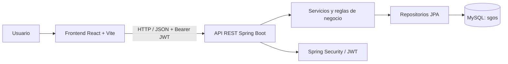
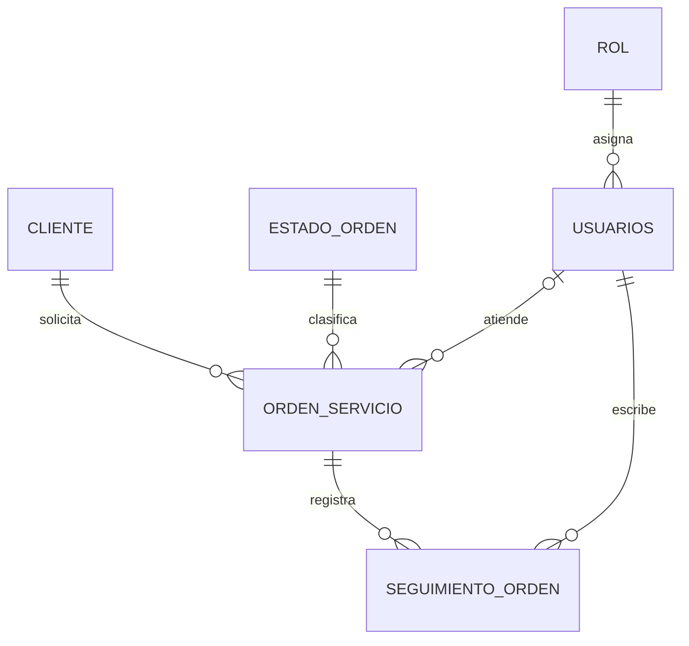

<div align="center">


# SGOS
### Sistema Gestor de Órdenes de Servicio

**Plataforma web para administrar clientes, usuarios y órdenes de servicio, con seguimiento de actividades y control de acceso por roles.**


[Repositorio](https://github.com/andresanajares-cmd/SGOS) · [Instalación](#-instalación-y-ejecución) · [API REST](#-api-rest) · [Arquitectura](#-arquitectura)

</div>

---

## 📌 Descripción

**SGOS** es una aplicación web para centralizar la gestión de órdenes de servicio. Permite registrar clientes, crear y asignar solicitudes, consultar su estado, registrar seguimientos y administrar usuarios según su rol. El frontend está construido con React y se comunica con una API REST desarrollada en Spring Boot, que utiliza MySQL para persistencia.

**Estado del proyecto:** finalizado como solución de ejecución local. Esta indicación describe el alcance del proyecto; no implica que exista un despliegue público o una certificación de seguridad.

## 🧭 Contenido

- [Funcionalidades](#-funcionalidades)
- [Tecnologías](#-tecnologías)
- [Arquitectura](#-arquitectura)
- [Modelo de datos](#-modelo-de-datos)
- [Estructura del repositorio](#-estructura-del-repositorio)
- [Instalación y ejecución](#-instalación-y-ejecución)
- [Uso del sistema](#-uso-del-sistema)
- [API REST](#-api-rest)
- [Seguridad](#-seguridad)
- [Verificación y solución de problemas](#-verificación-y-solución-de-problemas)
- [Autor](#-autor)

## ✨ Funcionalidades

| Módulo | Capacidades |
|:--|:--|
| 🏠 **Inicio** | Panel con resumen de órdenes, indicadores y actividad reciente. |
| 📋 **Solicitudes** | Crear, consultar, editar y eliminar órdenes; cambiar estados, filtrar y paginar resultados. |
| 🧑‍💼 **Clientes** | Registro, consulta, edición y eliminación de clientes. |
| 👥 **Usuarios y roles** | Consultar usuarios, registrar técnicos, cambiar roles y activar o desactivar cuentas. |
| 📝 **Seguimientos** | Registrar y consultar comentarios vinculados a cada orden, con usuario y fecha de registro. |
| 🔐 **Autenticación** | Inicio y cierre de sesión con tokens JWT y rutas protegidas. |
| 📱 **Interfaz adaptable** | Navegación responsive, menú lateral contraíble y transiciones visuales. |

> Las acciones disponibles para cada usuario dependen de los permisos configurados en el backend.

## 🛠️ Tecnologías

| Capa | Tecnología | Uso |
|:--|:--|:--|
| **Frontend** | React 19, Vite 8, React Router 7 | Interfaz de usuario, compilación y navegación |
| **Estilos e interacción** | CSS, Bootstrap Icons, Motion, Sonner, SweetAlert2 | Diseño, animaciones, avisos y confirmaciones |
| **HTTP** | Axios | Comunicación con la API REST |
| **Backend** | Java 21, Spring Boot 4.1.1 | API REST y lógica del servidor |
| **Persistencia** | Spring Data JPA, Hibernate, MySQL Connector/J | Acceso a la base de datos |
| **Seguridad** | Spring Security, OAuth2 Resource Server, JWT HS256 | Autenticación y validación de tokens |
| **Construcción** | Maven y npm | Dependencias y ejecución |
| **Pruebas manuales** | Postman | Comprobación de endpoints |
| **Versionamiento** | Git y GitHub | Control de versiones |

## 🏗️ Arquitectura



La interfaz envía peticiones HTTP a `http://localhost:8080/api`. Cuando existe una sesión, el cliente Axios incorpora el token en la cabecera `Authorization: Bearer <token>`.

## 🗃️ Modelo de datos

Entidades principales identificadas en el backend:

| Entidad / tabla | Datos relevantes | Relaciones |
|:--|:--|:--|
| **Cliente** / `clientes` | ID, nombre, correo, teléfono, dirección | Puede tener órdenes de servicio |
| **Usuarios** / `usuarios` | ID, nombre, correo, contraseña, teléfono, activo | Pertenece a un rol; puede recibir órdenes y registrar seguimientos |
| **Rol** / `roles` | ID, nombre | Asociado a usuarios |
| **EstadoOrden** / `estados_orden` | ID, nombre | Asociado a órdenes |
| **OrdenServicio** / `ordenes_servicios` | ID, descripción, fecha | Asociada a cliente, estado y técnico opcional |
| **SeguimientoOrden** / `seguimientos_orden` | ID, comentario, fecha de registro | Asociado a una orden y a un usuario |



> El esquema se gestiona mediante JPA/Hibernate con `spring.jpa.hibernate.ddl-auto=update`. Esto permite actualizar tablas, pero **no sustituye** las migraciones controladas ni los respaldos de datos.

## 📂 Estructura del repositorio

```text
SGOS/
├── .mvn/wrapper/           # Maven Wrapper
├── .postman/               # Material de Postman
├── frontend/               # Aplicación React
│   ├── public/             # Recursos estáticos, incluido el logo
│   ├── src/
│   │   ├── components/     # Layout y componentes reutilizables
│   │   ├── pages/          # Login, Inicio, Solicitudes, Clientes, Usuarios
│   │   └── services/       # API, autenticación y servicios HTTP
│   └── package.json
├── frontend-respaldo/      # Carpeta de respaldo presente en el repositorio
├── postman/                # Recursos para pruebas de API
├── src/main/java/com/sgos/
│   ├── controllers/        # Endpoints REST
│   ├── dto/                # Objetos de entrada y salida
│   ├── entities/           # Entidades JPA
│   ├── repositories/       # Persistencia
│   ├── security/           # Autenticación y validación JWT
│   └── services/           # Lógica de negocio
├── src/main/resources/
│   └── application.properties
├── mvnw
├── mvnw.cmd
├── pom.xml
└── README.md
```

## 🚀 Instalación y ejecución

### 1. Requisitos

| Herramienta | Requisito |
|:--|:--|
| JDK | **Java 21** |
| Node.js y npm | Versión compatible con **Vite 8** (verifica los requisitos de Node de esa versión) |
| MySQL Server | Servidor MySQL operativo |
| Git | Para clonar el repositorio |
| Maven | Opcional: el repositorio incluye Maven Wrapper |

### 2. Clonar el proyecto

```bash
git clone https://github.com/andresanajares-cmd/SGOS.git
cd SGOS
```

### 3. Crear la base de datos

Desde MySQL Workbench o un cliente SQL:

```sql
CREATE DATABASE IF NOT EXISTS sgos
  CHARACTER SET utf8mb4
  COLLATE utf8mb4_unicode_ci;
```

### 4. Configurar el backend

El archivo `src/main/resources/application.properties` utiliza **variables de entorno**, no contraseñas escritas directamente:

```properties
spring.application.name=sgos
spring.datasource.url=jdbc:mysql://localhost:3306/sgos
spring.datasource.username=${DB_USERNAME}
spring.datasource.password=${DB_PASSWORD}
spring.datasource.driver-class-name=com.mysql.cj.jdbc.Driver
spring.jpa.database-platform=org.hibernate.dialect.MySQLDialect
spring.jpa.hibernate.ddl-auto=update
jwt.secret=${JWT_SECRET}
jwt.expiration=3600
```

Define `DB_USERNAME`, `DB_PASSWORD` y `JWT_SECRET` en tu entorno antes de iniciar. **No publiques valores reales en GitHub.** El secreto JWT debe ser aleatorio, suficientemente largo y compatible con HS256.

Ejemplo de configuración para **PowerShell** (reemplaza los valores de ejemplo en tu equipo):

```powershell
$env:DB_USERNAME="tu_usuario_mysql"
$env:DB_PASSWORD="tu_contrasena_mysql"
$env:JWT_SECRET="tu_secreto_aleatorio_seguro_de_al_menos_32_bytes"
```

> Las variables definidas de esta forma se aplican a la terminal actual. No compartas capturas que revelen contraseñas o secretos.

### 5. Iniciar el backend

En la raíz del repositorio:

```powershell
.\mvnw.cmd spring-boot:run
```

En Linux/macOS:

```bash
./mvnw spring-boot:run
```

Por defecto, la API se ejecuta en **http://localhost:8080**.

### 6. Iniciar el frontend

En una **segunda terminal**:

```bash
cd frontend
npm install
npm run dev
```

Abre la dirección que muestre Vite en la consola (habitualmente **http://localhost:5173**).

> El frontend está configurado para comunicarse con `http://localhost:8080/api`. Si cambias el puerto del backend, actualiza `frontend/src/services/api.js`.

### 7. Acceder al sistema

Ingresa con una cuenta válida existente en la base de datos. La creación del usuario administrador inicial depende de la inicialización de datos de tu instalación; no se incluyen credenciales predeterminadas en este README.

## 🖥️ Uso del sistema

1. **Iniciar sesión:** ingresar correo electrónico y contraseña.
2. **Inicio:** consultar indicadores y órdenes recientes.
3. **Clientes:** registrar y mantener actualizados los datos de los clientes.
4. **Solicitudes:** crear órdenes, asociarlas a clientes, asignar técnicos y consultar su estado.
5. **Seguimientos:** abrir una orden para consultar su historial y registrar comentarios.
6. **Usuarios y roles:** administrar usuarios, sus roles y el estado de sus cuentas, según los permisos asignados.
7. **Cerrar sesión:** utilizar la opción del menú lateral.

### 📷 Capturas de pantalla

Para mostrar las pantallas reales, agrega las imágenes al directorio `docs/screenshots/` del repositorio y descomenta las líneas siguientes:

<!--
| Inicio de sesión | Panel principal |
|:--:|:--:|
|  |  |

| Solicitudes | Clientes |
|:--:|:--:|
|  |  |

| Usuarios y roles | Detalle y seguimiento |
|:--:|:--:|
|  |  |
-->

*Las capturas se incorporarán cuando estén disponibles; no se muestran imágenes ficticias del sistema.*

## 📡 API REST

**URL base:** `http://localhost:8080/api`

### Autenticación y usuarios

| Método | Endpoint | Función |
|:--:|:--|:--|
| `POST` | `/usuarios/login` | Iniciar sesión y obtener JWT |
| `POST` | `/usuarios` | Crear usuario técnico |
| `GET` | `/usuarios` | Listar usuarios |
| `GET` | `/usuarios/{id}` | Consultar usuario |
| `PATCH` | `/usuarios/{id}/estado` | Activar o desactivar usuario |
| `PATCH` | `/usuarios/{id}/rol` | Cambiar rol |

**Ejemplo de inicio de sesión:**

```http
POST /api/usuarios/login
Content-Type: application/json
```

```json
{
  "correo": "usuario@ejemplo.com",
  "contrasena": "tu_contrasena"
}
```

La respuesta incluye el token JWT, su tipo (`Bearer`) y datos básicos del usuario autenticado.

### Clientes

| Método | Endpoint | Función |
|:--:|:--|:--|
| `GET` | `/clientes` | Listar clientes |
| `GET` | `/clientes/{id}` | Consultar cliente |
| `POST` | `/clientes` | Crear cliente |
| `PUT` | `/clientes/{id}` | Actualizar cliente |
| `DELETE` | `/clientes/{id}` | Eliminar cliente |

### Órdenes de servicio

| Método | Endpoint | Función |
|:--:|:--|:--|
| `GET` | `/ordenesservicios` | Listar, filtrar, ordenar y paginar órdenes |
| `GET` | `/ordenesservicios/{id}` | Consultar orden |
| `POST` | `/ordenesservicios` | Crear orden |
| `PUT` | `/ordenesservicios/{id}` | Actualizar orden |
| `DELETE` | `/ordenesservicios/{id}` | Eliminar orden |
| `PATCH` | `/ordenesservicios/{id}/estado` | Cambiar estado |
| `GET` | `/ordenesservicios/mis-ordenes` | Consultar órdenes del usuario autenticado |

Parámetros opcionales de `GET /ordenesservicios`:

| Parámetro | Descripción | Predeterminado |
|:--|:--|:--|
| `estadoId` | Filtrar por estado | Sin filtro |
| `clienteId` | Filtrar por cliente | Sin filtro |
| `tecnicoId` | Filtrar por técnico | Sin filtro |
| `descripcion` | Filtrar por descripción | Sin filtro |
| `page` | Número de página, desde 0 | `0` |
| `size` | Registros por página (1–100) | `10` |
| `ordenarPor` | `id`, `fecha` o `descripcion` | `fecha` |
| `direccion` | `asc` o `desc` | `desc` |

### Seguimientos y estados

| Método | Endpoint | Función |
|:--:|:--|:--|
| `GET` | `/ordenesservicios/{ordenId}/seguimientos` | Listar seguimientos de una orden |
| `POST` | `/ordenesservicios/{ordenId}/seguimientos` | Registrar seguimiento |
| `GET` | `/estados` | Consultar estados disponibles |

Los comentarios de seguimiento tienen una longitud máxima de **1000 caracteres** en el modelo de persistencia.

> **Nota:** las tablas describen rutas implementadas en los controladores proporcionados. Las restricciones de acceso concretas se definen en la configuración de Spring Security y en los servicios.

## 🔒 Seguridad

- Autenticación con **JWT firmado mediante HS256**.
- Los tokens incluyen emisor, correo del usuario, identificador, rol, fecha de emisión y expiración.
- La duración configurada del token es de **3600 segundos (1 hora)**.
- Un validador comprueba que el usuario exista, esté activo y que el rol e identificador coincidan con los del token.
- El frontend incorpora el token a las solicitudes mediante un interceptor Axios.
- El cierre de sesión elimina la sesión del cliente y devuelve al formulario de acceso.
- Las credenciales de base de datos y la clave JWT se obtienen de variables de entorno.

**Recomendación para despliegues externos:** usar HTTPS, gestionar secretos de forma segura, definir políticas CORS apropiadas y revisar la configuración completa de autorización antes de exponer la aplicación a Internet.

## 🧪 Verificación y solución de problemas

Se incluyen carpetas de recursos de **Postman** para apoyar las pruebas manuales de la API. También puedes ejecutar las tareas disponibles en el proyecto:

```bash
# Frontend: desde frontend/
npm run lint
npm run build

# Backend: desde la raíz
./mvnw test
```

Estos comandos son **opciones de verificación**, no una afirmación de que se hayan ejecutado con éxito en este documento.

| Situación | Revisión sugerida |
|:--|:--|
| El backend no inicia | Confirmar Java 21, MySQL activo y variables `DB_USERNAME`, `DB_PASSWORD`, `JWT_SECRET` |
| Error de conexión a MySQL | Verificar que exista la base `sgos` y que el servidor escuche en el puerto `3306` |
| El frontend no obtiene datos | Verificar backend en `localhost:8080` y la URL base de Axios |
| Respuesta `401` | Iniciar sesión nuevamente y comprobar que el usuario esté activo |
| Respuesta `403` | Revisar si el rol tiene permiso para realizar la acción |
| El logo no aparece | Comprobar que exista `frontend/public/sgos-logo.png` |

## 👨‍💻 Autor

**Andrés Sebastián Anajar González**  
Tecnólogo en Análisis y Desarrollo de Software — SENA  

🔗 **Repositorio:** [github.com/andresanajares-cmd/SGOS](https://github.com/andresanajares-cmd/SGOS)

---

<div align="center">
  <strong>SGOS · Sistema Gestor de Órdenes de Servicio</strong><br/>
  <sub>Proyecto finalizado · Aplicación web de ejecución local</sub>
</div>
